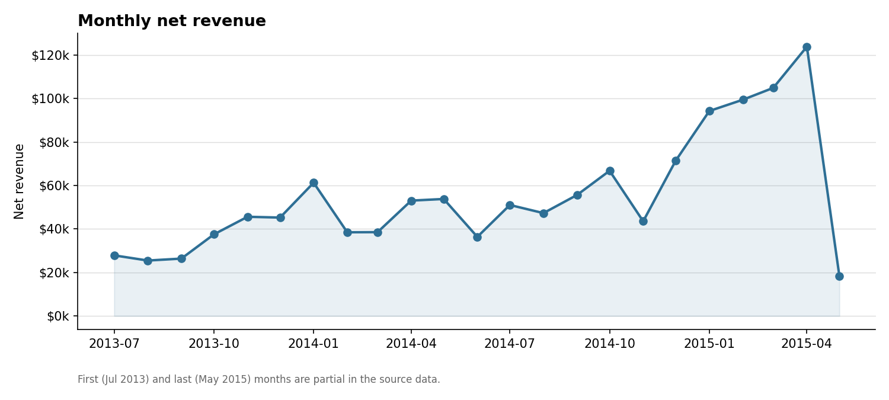
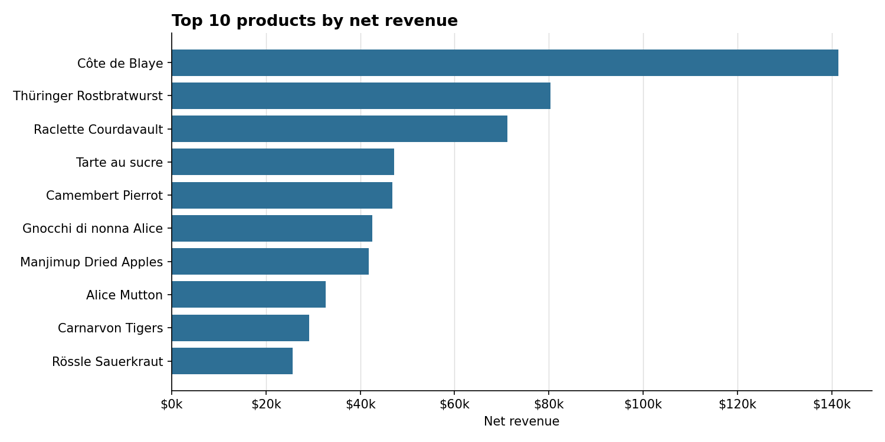
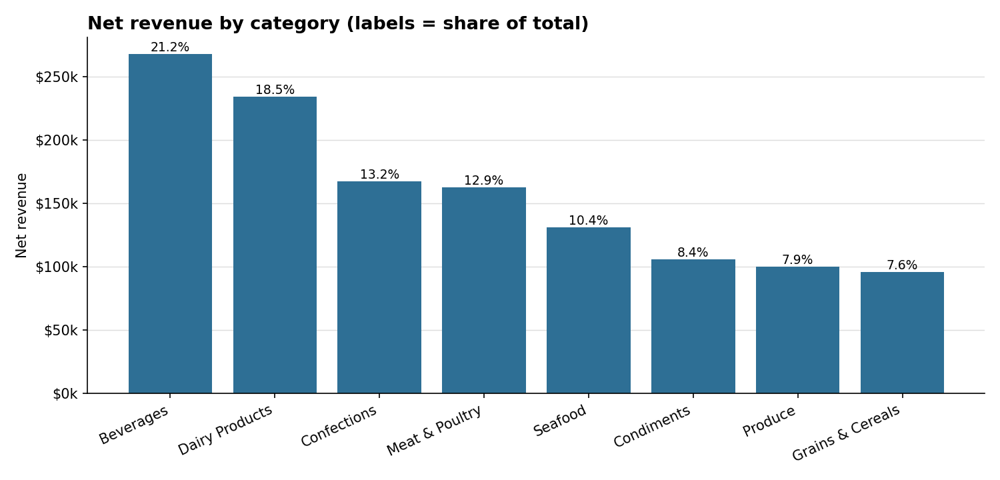
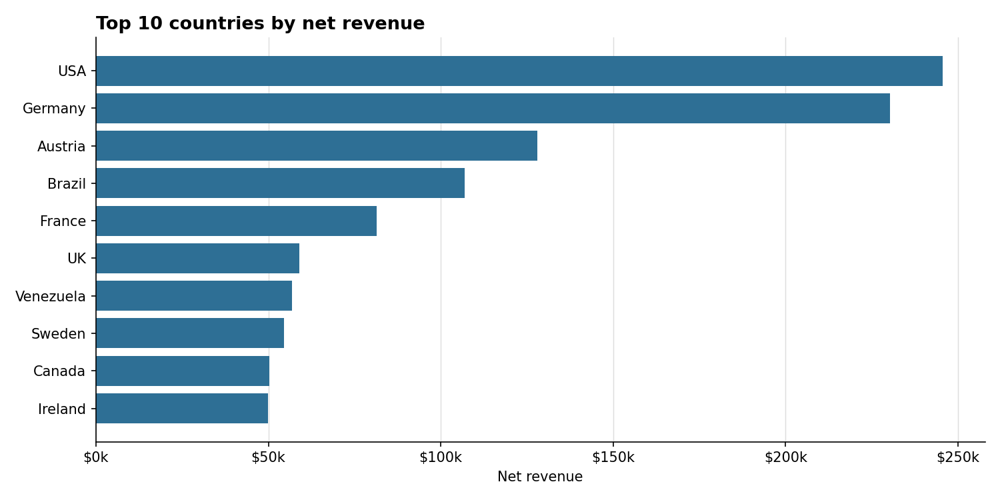
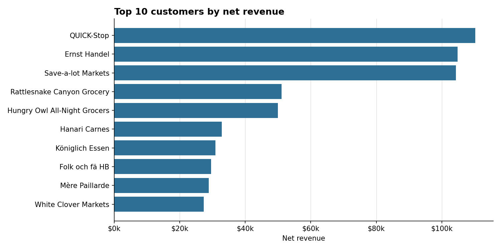
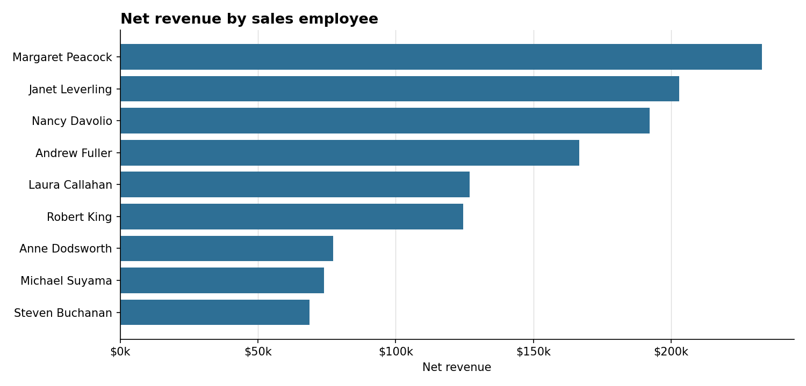
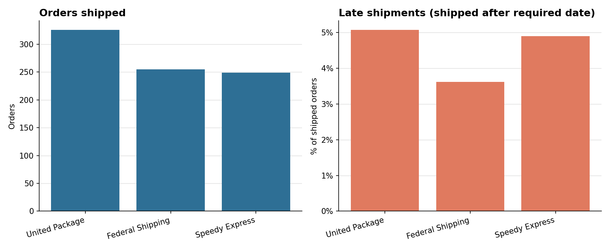
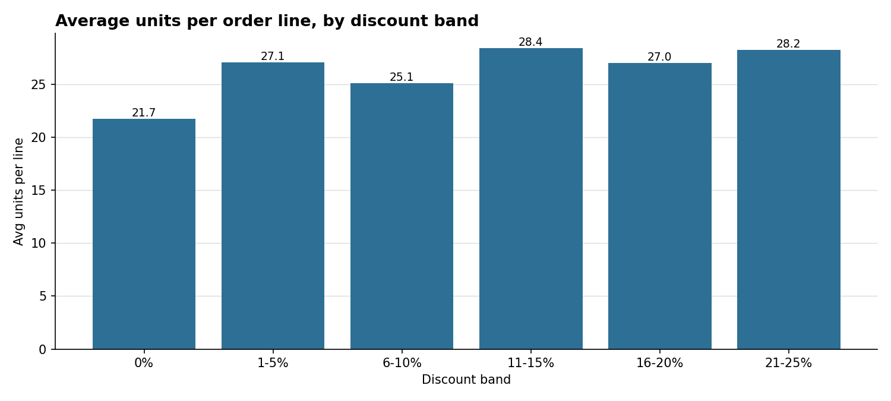

# Sales Analysis Report

**Period covered:** 04 Jul 2013 to 06 May 2015
**Grain:** one row per order line, joined across orders, order details, customers, products, categories, employees and shippers.

## Headline KPIs

| Metric | Value |
|---|---|
| Net revenue | $1,265,793 |
| Gross revenue (before discounts) | $1,354,459 |
| Discounts given | $88,666 |
| Orders | 830 |
| Units sold | 51,317 |
| Active customers | 89 |
| Products sold | 77 |
| Average order value | $1,525 |
| Freight (per order, counted once) | $64,943 |
| Late shipments (of shipped) | 4.6% |
| Avg days order to shipment | 8.5 |

## Key findings

- Total net revenue is $1,265,793 across 830 orders and 89 customers, after $88,666 in discounts.
- **Côte de Blaye** is the top product at $141,397 (11.2% of revenue). The top three products make up 23.1% of revenue.
- **Beverages** is the leading category with 21.2% of net revenue.
- **USA** is the top customer country at $245,585, followed by Germany, Austria.
- **Margaret Peacock** (Sales Representative) generated the most revenue, $232,891 from 156 orders.
- Overall, 4.6% of shipped orders arrived after the required date, averaging 8.5 days from order to shipment. United Package has the highest late rate (5.1%).
- Discounted order lines average 27.1 units versus 21.7 for undiscounted lines. Discounts appear to be used on larger orders. This is a correlation and does not show that discounts caused the larger orders.
- 2014 is the only full calendar year in the data, with $617,085 net revenue. Compare years only on full periods, because 2013 and 2015 are partial.

## Yearly performance

| Year | Net revenue | Orders | Units | First order | Last order | Avg order value |
|---|---|---|---|---|---|---|
| 2013 | $208,084 | 152 | 9581 | 2013-07-04 | 2013-12-31 | $1,369 |
| 2014 | $617,085 | 408 | 25489 | 2014-01-01 | 2014-12-31 | $1,512 |
| 2015 | $440,624 | 270 | 16247 | 2015-01-01 | 2015-05-06 | $1,632 |

## Monthly trend

## Products

| Product | Category | Units | Orders | Net revenue | Share |
|---|---|---|---|---|---|
| Côte de Blaye | Beverages | 623 | 24 | $141,397 | 11.2% |
| Thüringer Rostbratwurst | Meat & Poultry | 746 | 32 | $80,369 | 6.3% |
| Raclette Courdavault | Dairy Products | 1496 | 54 | $71,156 | 5.6% |
| Tarte au sucre | Confections | 1083 | 48 | $47,235 | 3.7% |
| Camembert Pierrot | Dairy Products | 1577 | 51 | $46,825 | 3.7% |
| Gnocchi di nonna Alice | Grains & Cereals | 1263 | 50 | $42,593 | 3.4% |
| Manjimup Dried Apples | Produce | 886 | 39 | $41,820 | 3.3% |
| Alice Mutton | Meat & Poultry | 978 | 37 | $32,698 | 2.6% |
| Carnarvon Tigers | Seafood | 539 | 27 | $29,172 | 2.3% |
| Rössle Sauerkraut | Produce | 640 | 33 | $25,697 | 2.0% |

## Categories

| Category | Products | Units | Net revenue | Share |
|---|---|---|---|---|
| Beverages | 12 | 9532 | $267,868 | 21.2% |
| Dairy Products | 10 | 9149 | $234,507 | 18.5% |
| Confections | 13 | 7906 | $167,357 | 13.2% |
| Meat & Poultry | 6 | 4199 | $163,022 | 12.9% |
| Seafood | 12 | 7681 | $131,262 | 10.4% |
| Condiments | 12 | 5298 | $106,047 | 8.4% |
| Produce | 5 | 2990 | $99,985 | 7.9% |
| Grains & Cereals | 7 | 4562 | $95,745 | 7.6% |

## Geography

| Country | Customers | Orders | Net revenue | Avg order value |
|---|---|---|---|---|
| USA | 13 | 122 | $245,585 | $2,013 |
| Germany | 11 | 122 | $230,285 | $1,888 |
| Austria | 2 | 40 | $128,004 | $3,200 |
| Brazil | 9 | 83 | $106,926 | $1,288 |
| France | 10 | 77 | $81,358 | $1,057 |
| UK | 7 | 56 | $58,971 | $1,053 |
| Venezuela | 4 | 46 | $56,811 | $1,235 |
| Sweden | 2 | 37 | $54,495 | $1,473 |
| Canada | 3 | 30 | $50,196 | $1,673 |
| Ireland | 1 | 19 | $49,980 | $2,631 |

## Customers

| Customer | Country | Orders | Net revenue | Avg order value |
|---|---|---|---|---|
| QUICK-Stop | Germany | 28 | $110,277 | $3,938 |
| Ernst Handel | Austria | 30 | $104,875 | $3,496 |
| Save-a-lot Markets | USA | 31 | $104,362 | $3,367 |
| Rattlesnake Canyon Grocery | USA | 18 | $51,098 | $2,839 |
| Hungry Owl All-Night Grocers | Ireland | 19 | $49,980 | $2,631 |
| Hanari Carnes | Brazil | 14 | $32,841 | $2,346 |
| Königlich Essen | Germany | 14 | $30,908 | $2,208 |
| Folk och fä HB | Sweden | 19 | $29,568 | $1,556 |
| Mère Paillarde | Canada | 13 | $28,872 | $2,221 |
| White Clover Markets | USA | 14 | $27,364 | $1,955 |

## Sales team

| Employee | Title | Orders | Customers | Net revenue | Avg order value |
|---|---|---|---|---|---|
| Margaret Peacock | Sales Representative | 156 | 75 | $232,891 | $1,493 |
| Janet Leverling | Sales Representative | 127 | 63 | $202,813 | $1,597 |
| Nancy Davolio | Sales Representative | 123 | 65 | $192,108 | $1,562 |
| Andrew Fuller | Vice President Sales | 96 | 59 | $166,538 | $1,735 |
| Laura Callahan | Sales Manager | 104 | 56 | $126,862 | $1,220 |
| Robert King | Sales Representative | 72 | 45 | $124,568 | $1,730 |
| Anne Dodsworth | Sales Representative | 43 | 29 | $77,308 | $1,798 |
| Michael Suyama | Sales Representative | 67 | 43 | $73,913 | $1,103 |
| Steven Buchanan | Sales Manager | 42 | 29 | $68,792 | $1,638 |

## Logistics

| Shipper | Orders | Freight | Avg days to ship | Late rate |
|---|---|---|---|---|
| United Package | 326 | $28,245 | 9.2 | 5.1% |
| Federal Shipping | 255 | $20,513 | 7.5 | 3.6% |
| Speedy Express | 249 | $16,185 | 8.6 | 4.9% |

## Discounts

| Discount | Order lines | Avg units per line | Net revenue | Discount given |
|---|---|---|---|---|
| 0% | 1317 | 21.7 | $750,699 | $0 |
| 1-5% | 192 | 27.1 | $147,906 | $7,778 |
| 6-10% | 174 | 25.1 | $91,563 | $10,171 |
| 11-15% | 157 | 28.4 | $87,506 | $15,442 |
| 16-20% | 161 | 27.0 | $89,181 | $22,295 |
| 21-25% | 154 | 28.2 | $98,939 | $32,980 |

## Data quality checks

- No referential-integrity or duplicate-key issues found.

## Method notes

- Net revenue = unit price x quantity x (1 - discount). Unit price is the price charged on the order, not the current list price.
- Freight is stored per order, so it is counted once per order and never repeated per line.
- Late shipment = shipped date after required date. Orders with no shipped date are excluded from late and ship-time metrics.
